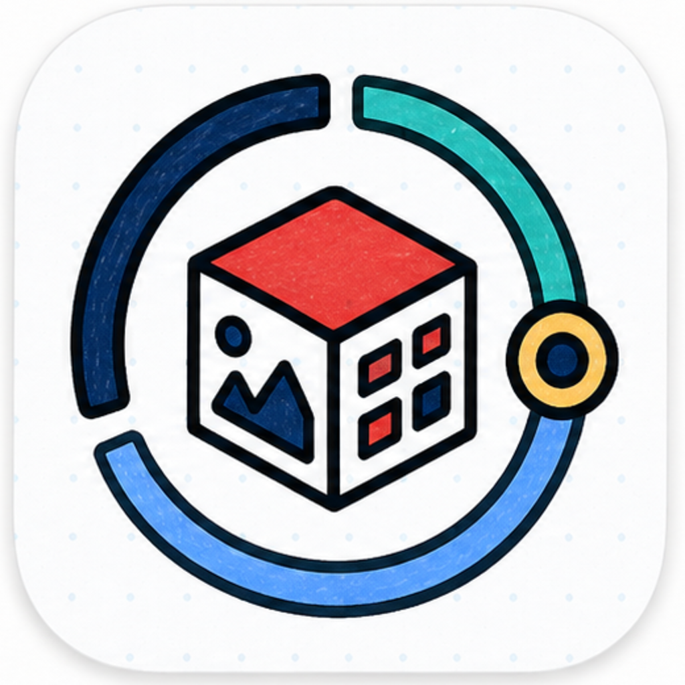
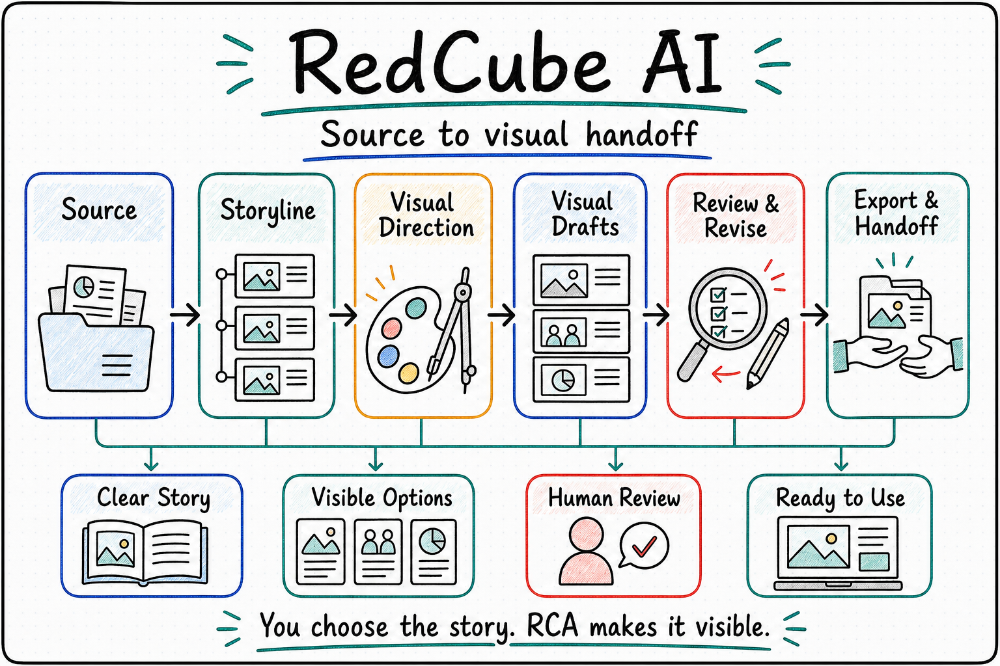

  

<strong>English</strong> | <a href="./README.zh-CN.md">中文</a>

<h1 align="center">RedCube AI</h1>

RedCube AI helps experts, teachers, and creative teams turn lecture notes, drafts, and references into slide decks, Xiaohongshu posts, or posters they can deliver.

  

## Take source material through to delivery

Tell RedCube AI your audience, purpose, and delivery format. It organizes the material into pages and chooses an approach suited to the result you need. Start by reviewing an outline, comparing visual directions, or building on a layout and artwork you already have. Once you approve the direction, it continues with production and export.

Review and revision stay in the same project. Feedback is tied to specific pages, so you can see which version addressed it and what remains. At delivery, you can trace the exported files back to their source material and review. You decide what is accurate, what works for the audience, and which version to use.

## Start with what you need to deliver

> “Turn these lecture notes into a deck for medical residents. Show me the outline and three sample slides first. After I approve them, finish the deck and give me a PPTX and a PDF.”

> “Use the style we chose last time to turn this explainer into a set of Xiaohongshu posts. Flag the images you need from me and the pages that changed.”

## Get started

Install **RedCube AI** from the OPL Software Center. Open a project and share the material you have, the audience, and your delivery format. Start with a reviewable outline or sample pages. [Usage guide](docs/product/human_quickstart.md) · [Current status](docs/status.md)

[Image-first PPT route](docs/delivery/image-first-ppt-production-route.md) · [Export and review evidence](docs/delivery/image-deck-export.md) · [Documentation](docs/README.md) · [Architecture](docs/architecture.md)
