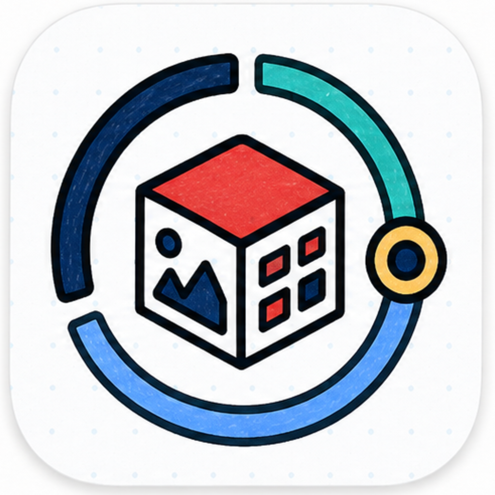
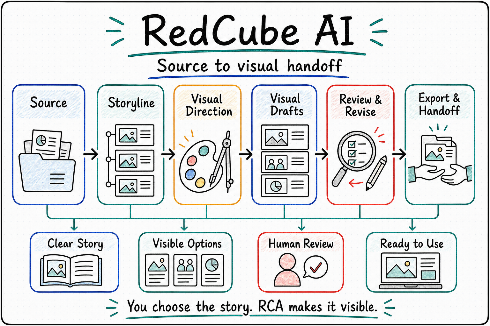

  

<a href="./README.md">English</a> | <strong>中文</strong>

<h1 align="center">RedCube AI</h1>

RedCube AI 帮专家、教师和创作团队把讲稿、笔记和参考材料做成可以交付的幻灯片、小红书笔记或海报。

  

## 从一份材料走到可用成品

交代受众、用途和交付格式后，RedCube AI 把材料组织成页面，针对成品选择合适的表达方式。你可以先看大纲、比较几个视觉方向，或带着已有的版式和画面继续。确认后，它推进页面制作和导出。

审稿和回修在同一个项目里进行。你给出的意见对应到具体页面，后续可以看到改过哪一版、还有哪些问题。交付时，成品、审阅结果和原始资料可以对上。你决定内容是否准确、表达是否适合受众，以及采用哪一版。

## 从你要交付的成品开始

> “把这份讲义做成一套给住院医讲课的幻灯片。先给我看大纲和三张样页，确认后做整套，最后给我 PPTX 和 PDF。”

> “沿用上次的画法把这篇科普稿做成一组小红书笔记。把需要我补充的图和修改过的页面标出来。”

## 开始使用

在 OPL 软件中心安装 **RedCube AI**。打开一个项目，给出已有材料、目标受众和交付格式。可以先从可审阅的大纲或样页开始。[使用入口](docs/product/human_quickstart.md) · [当前状态](docs/status.md)

[幻灯片制作与审阅](docs/delivery/ppt-workbench-learning.md) · [文档索引](docs/README.md) · [架构](docs/architecture.md)
